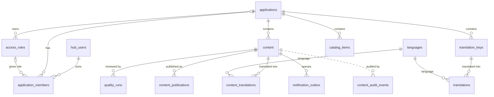
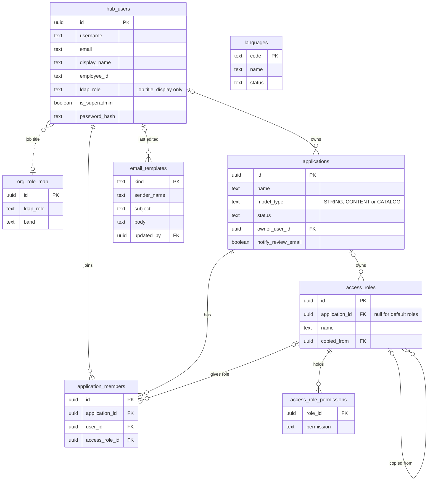
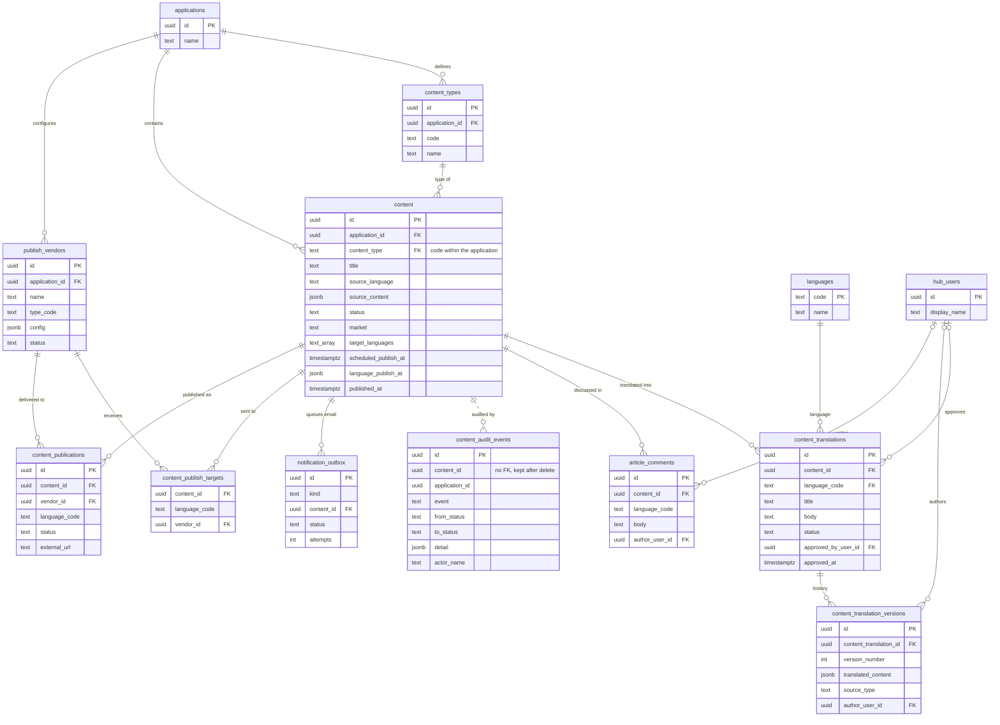
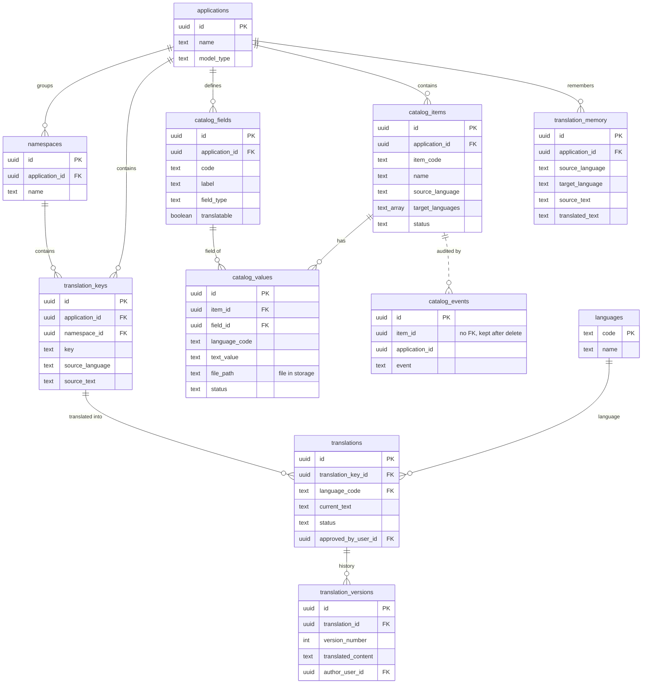

# Lingo — Entity Relationship Diagrams

Built from `supabase/migrations/001` to `029`. Each diagram shows primary keys (PK), foreign keys (FK) and the main columns only. Full column descriptions are in [technical-documentation.md](technical-documentation.md#41-tables).

To use a diagram in Lark, type `/Mermaid` on a blank line and paste the code inside one block. Leave out the ` ```mermaid ` lines.

| Diagram | Covers |
| --- | --- |
| 1. Overview | Every table and how the areas connect |
| 2. People and access | Users, applications, members, roles, permissions |
| 3. Articles | Articles, translations, versions, comments, audit, emails, publishing |
| 4. Quality review | Quality runs, scores, findings, terminology, boilerplate |
| 5. Strings and catalog | Product UI strings, catalog items, translation memory |

Notation: `||--o{` one to many, `|o--o{` optional one to many, `|o--o|` optional one to one. Dotted lines are links by value with no foreign key.

---

## 1. Overview



---

## 2. People and access



---

## 3. Articles



---

## 4. Quality review


---

## 5. Strings and catalog


