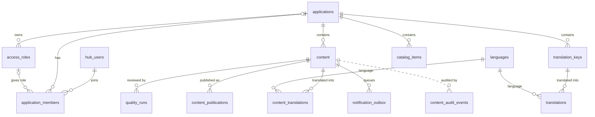
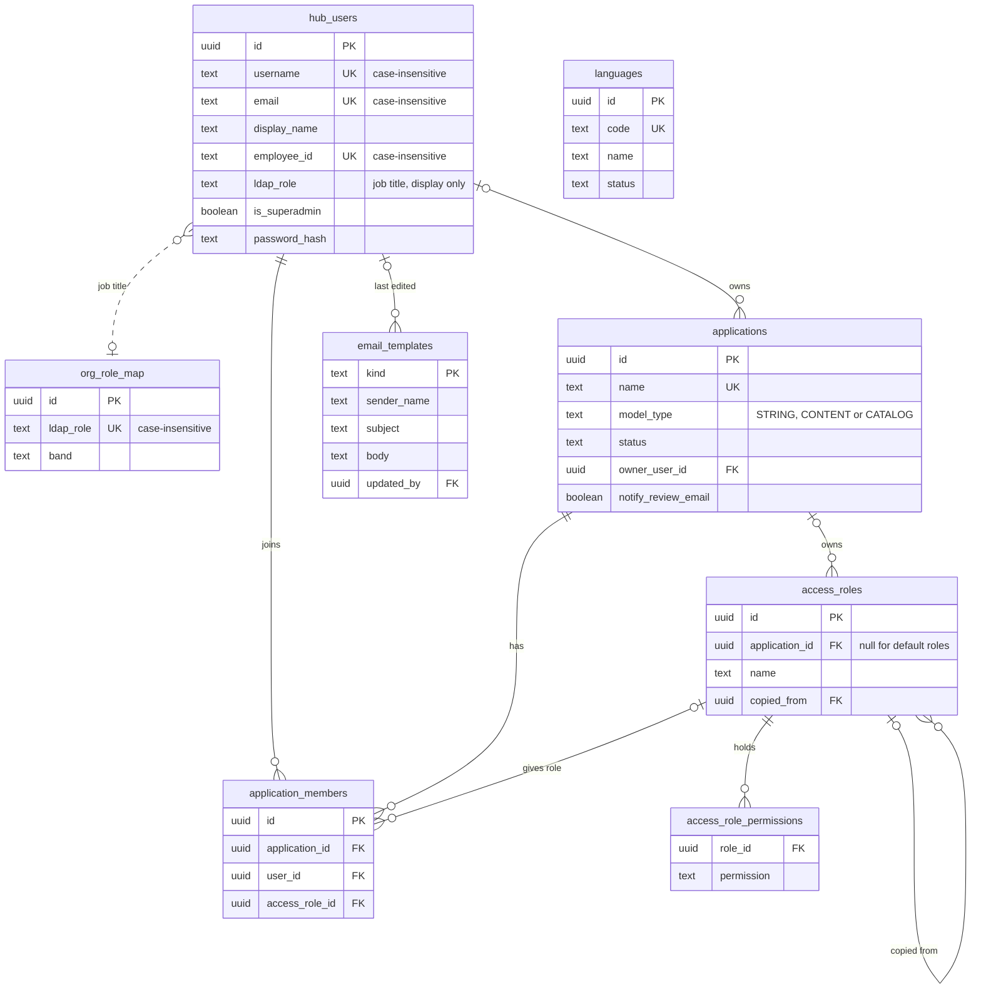
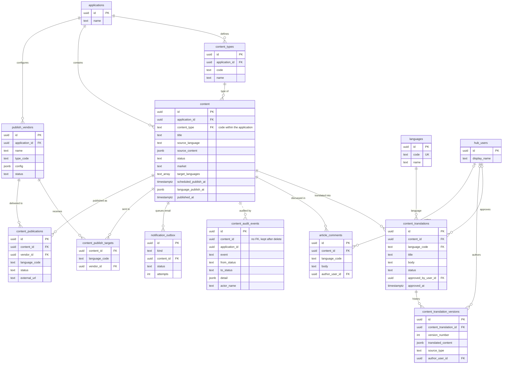
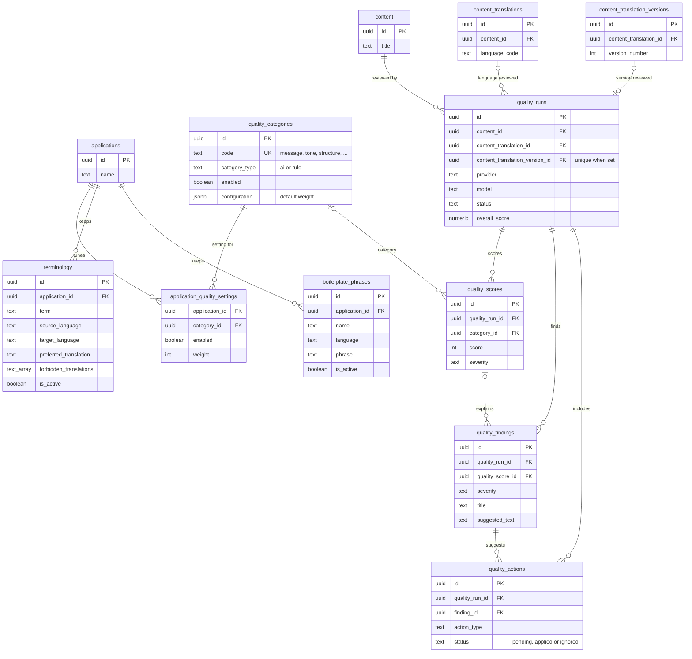
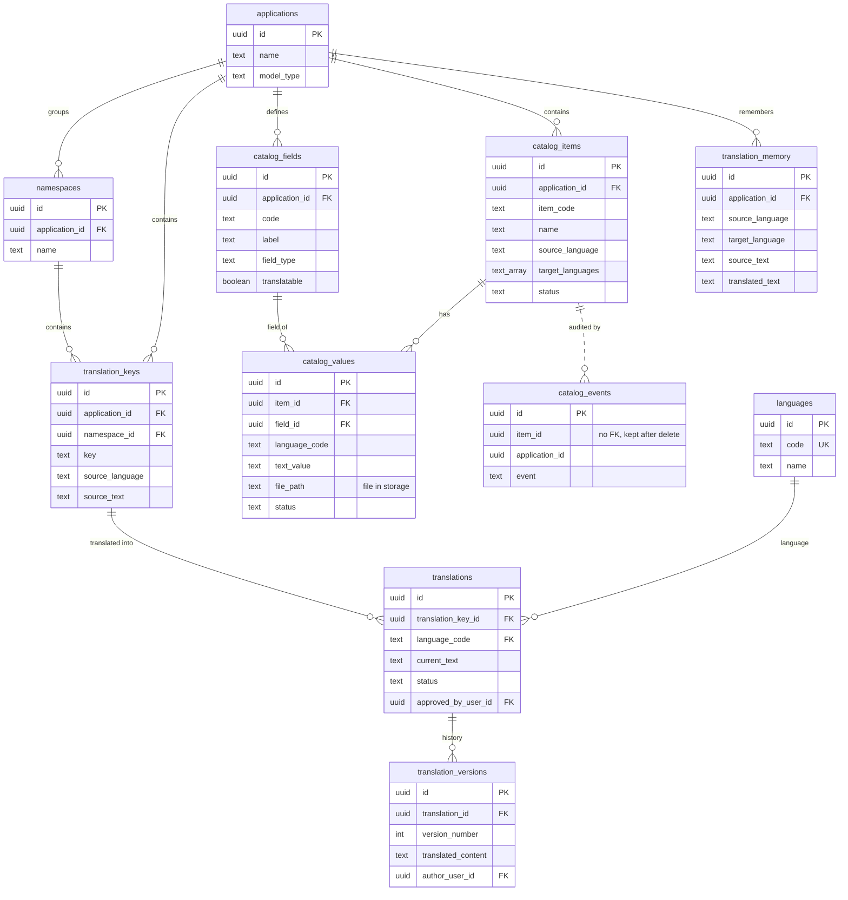

# Lingo — Entity Relationship Diagrams

Built from `supabase/migrations/001` to `030`. Each diagram shows primary keys (PK), foreign keys (FK), single-column unique keys (UK) and the main columns only. Indexes are listed in [section 6](#6-index-strategy). Full column descriptions are in [technical-documentation.md](technical-documentation.md#41-tables).

To use a diagram in Lark, type `/Mermaid` on a blank line and paste the code inside one block. Leave out the ` ```mermaid ` lines.

| Diagram | Covers |
| --- | --- |
| 1. Overview | Every table and how the areas connect |
| 2. People and access | Users, applications, members, roles, permissions |
| 3. Articles | Articles, translations, versions, comments, audit, emails, publishing |
| 4. Quality review | Quality runs, scores, findings, terminology, boilerplate |
| 5. Strings and catalog | Product UI strings, catalog items, translation memory |
| 6. Index strategy | Unique rules and lookup indexes for every table, and what migration 030 changed |

Notation: `||--o{` one to many, `|o--o{` optional one to many, `|o--o|` optional one to one. Dotted lines are links by value with no foreign key.

---

## 1. Overview



---

## 2. People and access



---

## 3. Articles



---

## 4. Quality review



---

## 5. Strings and catalog



---

## 6. Index strategy

Mermaid ER diagrams cannot show indexes, so they are listed here. Built from the `create index`, `unique` and `primary key` statements in migrations `001` to `030`, after the drops in `021`, `027`, `028` and `030`.

### How indexes are chosen

- **Every table has a `uuid` primary key** (UUID v7, so new rows sort by time), except join tables, which use a composite primary key (`content_publish_targets`, `application_quality_settings`, `access_role_permissions`), and `email_templates`, keyed by `kind`.
- **Business rules are enforced by unique indexes.** For example, a key is unique within an application, and an article has one translation per language.
- **Names people type are unique ignoring case.** These use `lower(...)` expression indexes: usernames, emails, role names, terminology, boilerplate and vendor names.
- **Indexes start with `application_id`.** Nearly every screen is scoped to one application, so `application_id` comes first, then the filter column (`status`, `market`), then the sort column (`created_at desc`, `updated_at desc`, `sort_order`).
- **Partial indexes cover sparse or "hot" rows only.** For example, scheduled articles, the outbox rows still waiting to send, active terminology and active boilerplate.
- **GIN indexes are used for arrays, JSON and fuzzy search.** These cover `content.target_languages`, `content.language_publish_at` and the trigram search on `translation_keys.key`, which needs the `pg_trgm` extension.
- **Every foreign key has an index that starts with it.** Deleting a parent row then finds its children without a table scan. Nullable foreign keys use a partial index (`where ... is not null`) so empty rows take no space.
- **Audit tables are indexed for reading the timeline.** `content_audit_events` and `catalog_events` are indexed on `(content_id or item_id, created_at desc)`.

Key: **U** unique, **P** partial (`where ...`), **G** GIN, **E** expression (`lower(...)`).

### 6.1 People and access

| Table | Index | Columns | Kind | Used for |
| --- | --- | --- | --- | --- |
| hub_users | `hub_users_username_lower` | `lower(username)` where not null | U E P | Sign-in by username |
| hub_users | `hub_users_email_lower` | `lower(email)` where not null | U E P | Look up a user by email |
| hub_users | `hub_users_employee_id_lower` | `lower(employee_id)` where not null | U E P | LDAP or employee ID match |
| org_role_map | `org_role_map_ldap_role_lower` | `lower(ldap_role)` | U E | Map a job title to a band |
| applications | unique constraint | `name` | U | One name per application |
| applications | `idx_applications_owner_user_id` | `owner_user_id` | | "Applications I own" |
| application_members | unique constraint | `(application_id, user_id)` | U | One membership per user, member list per application |
| application_members | `idx_application_members_user_id` | `user_id` | | "Applications I belong to" |
| application_members | `application_members_access_role_id` | `access_role_id` | | Role in use check before delete (`on delete restrict`) |
| access_roles | `access_roles_app_name_lower` | `(coalesce(application_id, zero uuid), lower(name))` | U E | Role names unique per application and among default roles |
| access_roles | `access_roles_application_id` | `application_id` | | Roles of one application |
| access_roles | `idx_access_roles_copied_from` | `copied_from` where not null | P | Role delete sets copies to null |
| access_role_permissions | primary key | `(role_id, permission)` | U | Permissions of a role |
| languages | unique constraint | `code` | U | Language FK target |
| email_templates | primary key | `kind` | U | One template per email kind |
| email_templates | `idx_email_templates_updated_by` | `updated_by` where not null | P | User delete sets editor to null |

### 6.2 Articles

| Table | Index | Columns | Kind | Used for |
| --- | --- | --- | --- | --- |
| content | `idx_content_app_status` | `(application_id, status)` | | Article list filtered by status |
| content | `idx_content_title` | `(application_id, title)` | | Sort and search by title |
| content | `idx_content_app_market` | `(application_id, market)` where market not null | P | Filter by market |
| content | `idx_content_app_slug` | `(application_id, slug)` where slug not empty | U P | Unique slug per application |
| content | `idx_content_target_languages` | `target_languages` | G | "Articles that target language X" |
| content | `idx_content_scheduled_publish` | `scheduled_publish_at` where not null | P | Scheduler picks articles due to publish |
| content | `idx_content_language_publish_at` | `language_publish_at` | G | Per-language publish schedule |
| content | `idx_content_published_at` | `published_at` where not null | P | Recently published |
| content_types | unique constraint | `(application_id, code)` | U | Composite FK target for `content` |
| content_types | `idx_content_types_app_status` | `(application_id, status, sort_order)` | | Content type picker |
| content_translations | unique constraint | `(content_id, language_code)` | U | One translation per language |
| content_translations | `idx_content_translations_approved_by` | `approved_by_user_id` where not null | P | User delete sets approver to null |
| content_translation_versions | unique constraint | `(content_translation_id, version_number)` | U | Version history in order |
| content_translation_versions | `idx_content_translation_versions_author` | `author_user_id` where not null | P | User delete sets author to null |
| article_comments | `idx_article_comments_content_created` | `(content_id, created_at)` | | Comment thread in order |
| article_comments | `idx_article_comments_author` | `author_user_id` where not null | P | User delete sets author to null |
| content_audit_events | `idx_content_audit_events_content` | `(content_id, created_at desc)` | | Article history |
| content_audit_events | `idx_content_audit_events_app` | `(application_id, created_at desc)` | | Application-wide activity log |
| notification_outbox | `idx_notification_outbox_pending` | `created_at` where status in (PENDING, SENDING) | P | Email worker takes the oldest pending row first |
| notification_outbox | `idx_notification_outbox_content` | `(content_id, kind, created_at desc)` | | Avoid duplicate emails, show the latest send |
| publish_vendors | `idx_publish_vendors_app_name` | `(application_id, lower(name))` | U E | Unique vendor name per application |
| publish_vendors | `idx_publish_vendors_app_status` | `(application_id, status)` | | Active vendors |
| content_publish_targets | primary key | `(content_id, language_code, vendor_id)` | U | Targets of one article |
| content_publish_targets | `idx_content_publish_targets_vendor` | `vendor_id` | | Vendor delete cascade |
| content_publications | unique constraint | `(content_id, vendor_id, language_code)` | U | One publication per vendor and language |
| content_publications | `idx_content_publications_content` | `(content_id, status)` | | Publish status of an article |
| content_publications | `idx_content_publications_vendor` | `vendor_id` | | Vendor delete cascade |

### 6.3 Quality review

| Table | Index | Columns | Kind | Used for |
| --- | --- | --- | --- | --- |
| quality_categories | unique constraint | `code` | U | Look up a category by code |
| application_quality_settings | primary key | `(application_id, category_id)` | U | Settings of one application |
| application_quality_settings | `idx_application_quality_settings_category` | `category_id` | | Category delete cascade |
| terminology | `terminology_app_pair_term` | `(application_id, lower(term), lower(source_language), lower(target_language))` | U E | One entry per term and language pair |
| terminology | `idx_terminology_app_pair_active` | `(application_id, source_language, target_language)` where is_active | P | Load the glossary for a review |
| boilerplate_phrases | `boilerplate_app_name_language` | `(application_id, lower(name), lower(language))` | U E | One phrase per name and language |
| boilerplate_phrases | `idx_boilerplate_app_active` | `application_id` where is_active | P | Load the phrases for a review |
| quality_runs | `idx_quality_runs_content_created` | `(content_id, target_language, created_at desc)` | | Latest run per article and language |
| quality_runs | `quality_runs_one_per_version` | `content_translation_version_id` where not null | U P | At most one run per version |
| quality_runs | `idx_quality_runs_content_translation` | `content_translation_id` where not null | P | Translation delete sets runs to null |
| quality_scores | `idx_quality_scores_run` | `quality_run_id` | | Scores of a run |
| quality_scores | `idx_quality_scores_category` | `category_id` where not null | P | Category delete sets scores to null |
| quality_findings | `idx_quality_findings_run` | `quality_run_id` | | Findings of a run |
| quality_findings | `idx_quality_findings_score` | `quality_score_id` where not null | P | Findings of one score |
| quality_actions | `idx_quality_actions_run_status` | `(quality_run_id, status)` | | Pending actions of a run |
| quality_actions | `idx_quality_actions_finding` | `finding_id` | | Actions of a finding, finding delete cascade |

### 6.4 Strings and catalog

| Table | Index | Columns | Kind | Used for |
| --- | --- | --- | --- | --- |
| namespaces | unique constraint | `(application_id, name)` | U | One namespace name per application |
| namespaces | `idx_namespaces_application_id` | `application_id` | | Namespaces of one application |
| translation_keys | unique constraint | `(application_id, key)` | U | One key per application |
| translation_keys | `idx_translation_keys_app_ns` | `(application_id, namespace_id)` | | Keys in a namespace |
| translation_keys | `idx_translation_keys_namespace` | `namespace_id` | | Namespace delete cascade |
| translation_keys | `idx_translation_keys_key_trgm` | `key gin_trgm_ops` | G | Partial-match key search (`ilike`) |
| translations | unique constraint | `(translation_key_id, language_code)` | U | One translation per language |
| translations | `idx_translations_status` | `status` | | Filter by status |
| translations | `idx_translations_approved_by` | `approved_by_user_id` where not null | P | User delete sets approver to null |
| translation_versions | unique constraint | `(translation_id, version_number)` | U | Version history in order |
| translation_versions | `idx_translation_versions_author` | `author_user_id` where not null | P | User delete sets author to null |
| catalog_fields | unique constraint | `(application_id, code)` | U | One field code per application |
| catalog_fields | `idx_catalog_fields_app` | `(application_id, sort_order)` | | Fields in display order |
| catalog_items | unique constraint | `(application_id, item_code)` | U | One SKU per application |
| catalog_items | `idx_catalog_items_app_status` | `(application_id, status, updated_at desc)` | | Item list filtered by status |
| catalog_items | `idx_catalog_items_app_updated` | `(application_id, updated_at desc)` | | Item list, newest first |
| catalog_values | unique constraint | `(item_id, field_id, language_code)` | U | One value per item, field and language |
| catalog_values | `idx_catalog_values_field` | `field_id` | | Field in use check before delete (`on delete restrict`) |
| translation_memory | unique constraint | `(application_id, source_language, target_language, source_hash)` | U | Exact-match lookup by source text hash |
| catalog_events | `idx_catalog_events_item` | `(item_id, created_at desc)` | | Item history |

### 6.5 Changes in migration 030

Migration `030_index_cleanup.sql` tidied the indexes from `001` to `029`. The tables in 6.1 to 6.4 already show the result.

- **Dropped 5 duplicate indexes.** Each had the same columns as a unique constraint, which already has its own index: `idx_translation_keys_app_key`, `idx_translations_key_lang`, `idx_translation_versions_tid_ver`, `idx_content_translations_cid_lang` and `idx_content_translation_versions_ctid_ver`.
- **Added 14 foreign key indexes**, listed in the tables above. Before, deleting a namespace, vendor, quality category or user scanned the child tables.

**Still to watch.** `idx_catalog_items_app_status` and `idx_catalog_items_app_updated` both serve the item list. Keep both only if the list is often shown without a status filter.
