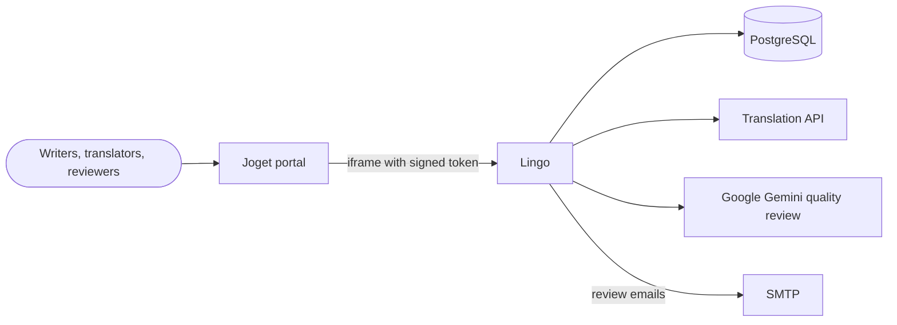
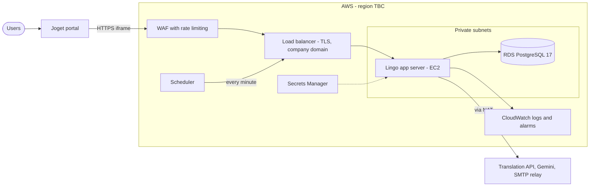
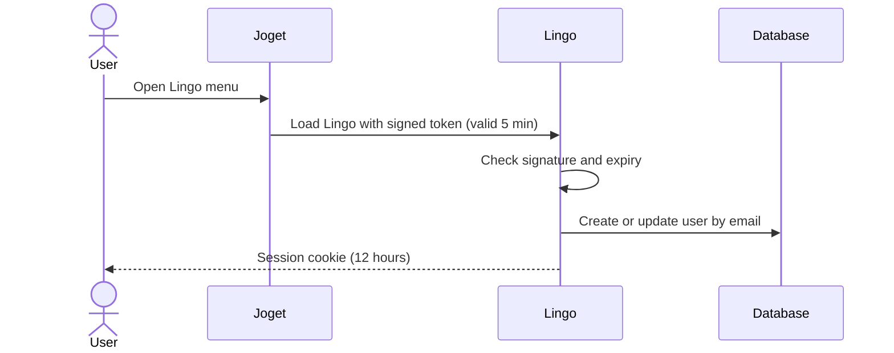
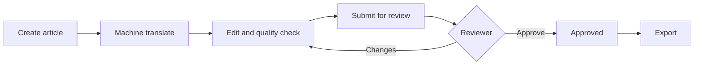

# Lingo — Translation Hub: High-Level Design

Version 0.3 · Draft · Phase 1

Details of the data model, permissions and flows are in [technical-documentation.md](technical-documentation.md). Items marked **TBC** need a decision.

---

## 1. Purpose and scope

Lingo is MR.DIY's internal hub for writing source copy, translating it, reviewing it and approving it before export or publishing.

| | |
| --- | --- |
| Phase 1 scope | Press and article translation: machine translation, quality review, approval workflow, review emails, Excel export, sign-in from Joget |
| Out of scope | Publishing to vendors (built, switched off in production), migration into Joget and finer settings (Phase 2), GTPC SKU content (Phase 3) |
| Go-live | Before end of December 2026, on AWS |

## 2. System context

| System | Role |
| --- | --- |
| Joget | Identity source. Opens Lingo in an iframe with a short-lived signed token |
| PostgreSQL | All Lingo data, including the audit trail and email queue |
| Translation API | First draft of each translation. Gemini now, OpenAI later **TBC** |
| Google Gemini | Scores translation quality. Advisory, does not block approval |
| SMTP | Review emails to approvers |

## 3. Production architecture

| Component | Design |
| --- | --- |
| Edge | Company subdomain (**TBC**), TLS certificate on the load balancer, AWS WAF with rate-based rules |
| App server | Next.js on EC2 in a private subnet. One instance in Phase 1 |
| Database | Amazon RDS for PostgreSQL 17, private, encrypted, automatic backups |
| Scheduler | Calls the email cron route every minute with a bearer secret |
| Secrets | AWS Secrets Manager |
| Logs | CloudWatch, with alarms on errors and resource use |
| Deployment | Phase 1: scripted manual deploy with a runbook, tested on pre-production. Phase 2: CI/CD with GitHub Actions |

## 4. Key flows

### 4.1 Sign in from Joget

### 4.2 Article workflow

## 5. Security

| Area | Design |
| --- | --- |
| Identity | Joget token signed with a shared secret. Lingo never sees Joget passwords |
| Session | Signed, httpOnly, secure cookie, 12 hours |
| Authorization | Checked on the server for every action, using roles and permissions per application |
| Network | App and database in private subnets. Only the load balancer is public. `JOGET_FRAME_ANCESTORS` limits embedding to Joget |
| Rate limiting | Phase 1: WAF rules and an AI spending cap. Phase 2: per-user AI limits and sign-in lockout |
| Data | TLS in transit, encrypted at rest. Article text is sent to the AI providers |
| Audit | Append-only article audit trail |

## 6. Environments

| Environment | Hosting | Database | Purpose |
| --- | --- | --- | --- |
| PoC / staging | Vercel | Supabase | Demo and UAT |
| Pre-production | AWS | RDS PostgreSQL | Test the AWS build and deploy script before go-live |
| Production | AWS | RDS PostgreSQL | Live, `APP_ENV=production` (publishing switched off) |

## 7. Non-functional requirements

| Requirement | Target |
| --- | --- |
| Users and volume | **TBC** |
| Availability | **TBC**, suggested 99.5% in Malaysia business hours |
| Response time | Screens under 2 seconds. Translation under about 30 seconds per language |
| Recovery | RPO 24 hours or less, RTO 4 hours or less **TBC** |
| Browsers | Current Chrome and Edge, inside Joget and on their own |

## 8. Risks and open decisions

| # | Item | Owner |
| --- | --- | --- |
| 1 | The app uses Supabase's API. Production on plain PostgreSQL needs a database access change, which is not yet on the Phase 1 timeline | Developer, Project lead |
| 2 | AWS region: Malaysia or Singapore | Architect, IT Security |
| 3 | Production domain | IT |
| 4 | Lingo open to the internet, or company network / VPN only | Architect, IT Security |
| 5 | Production translation provider | Business Owner |
| 6 | SMTP relay and sender address | IT |
| 7 | Year-end holidays during hypercare | Project lead |
