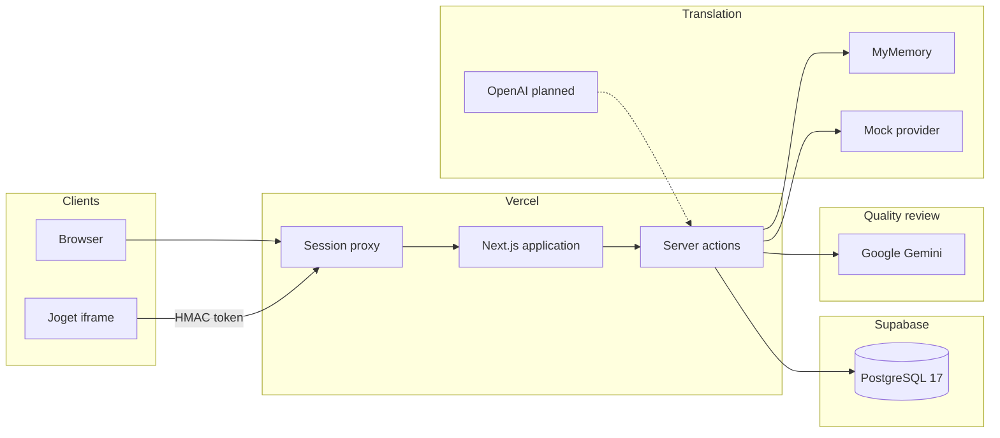
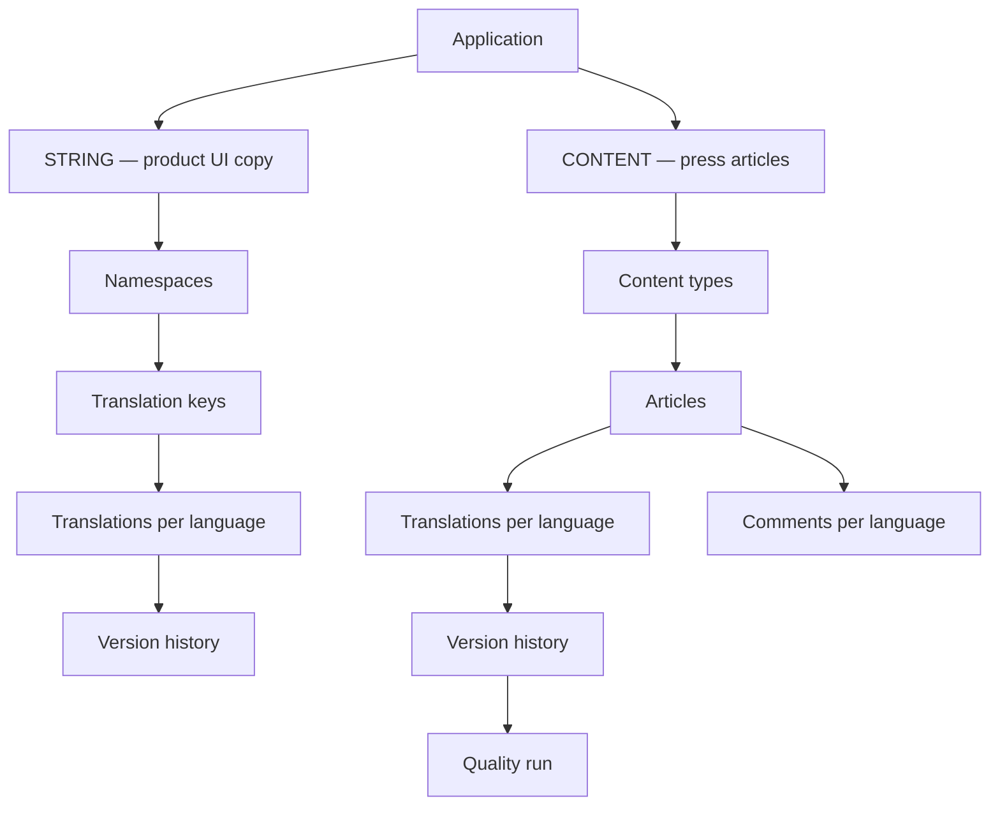
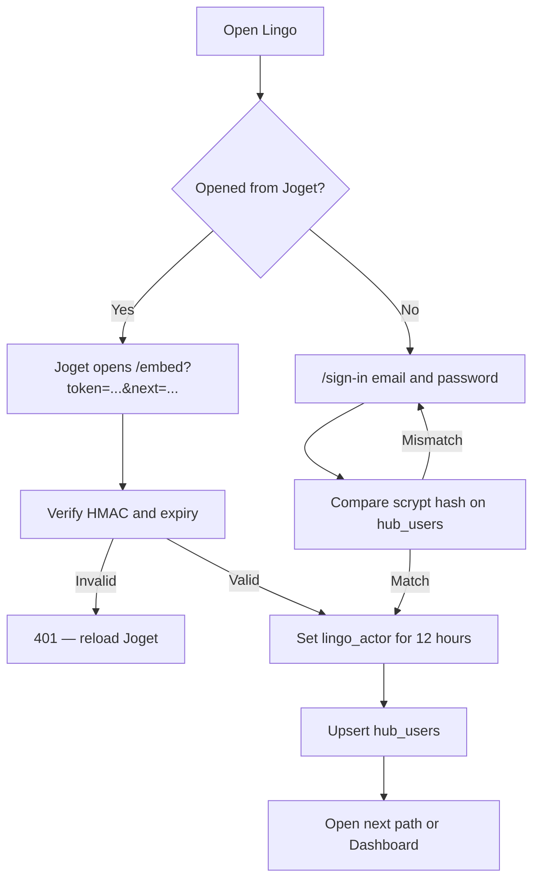
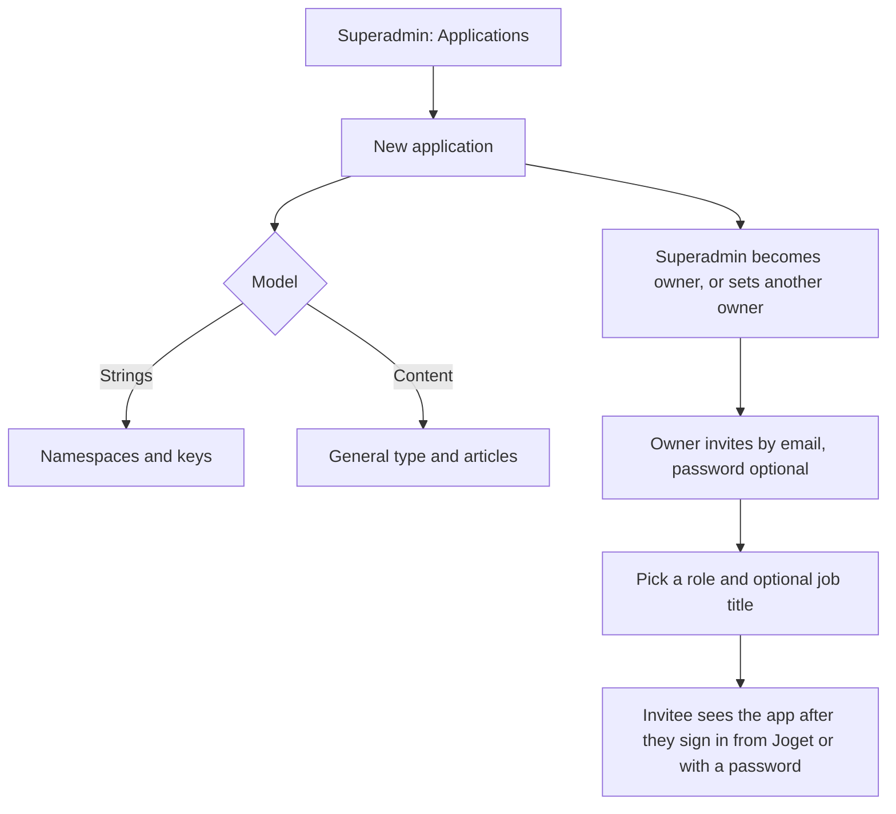
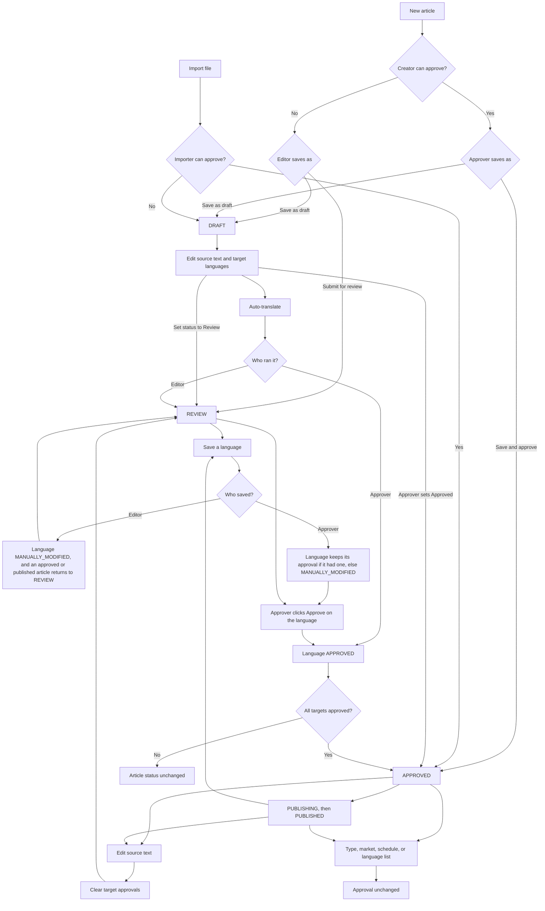
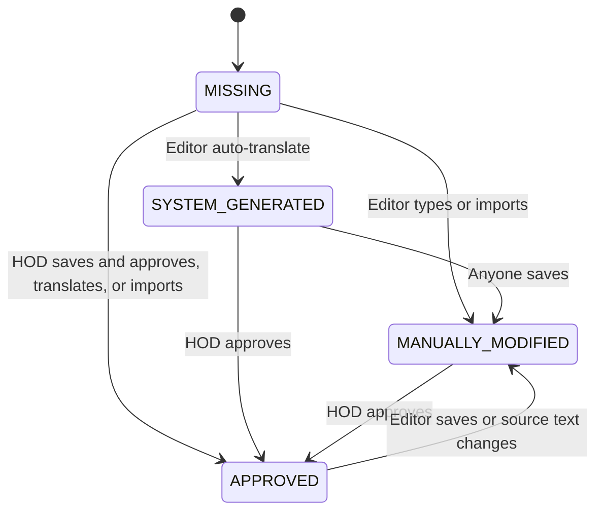
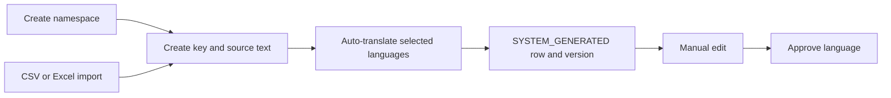
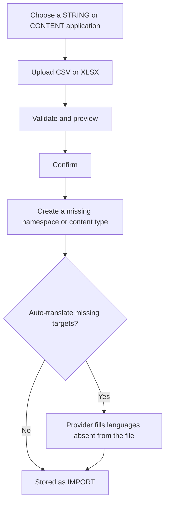
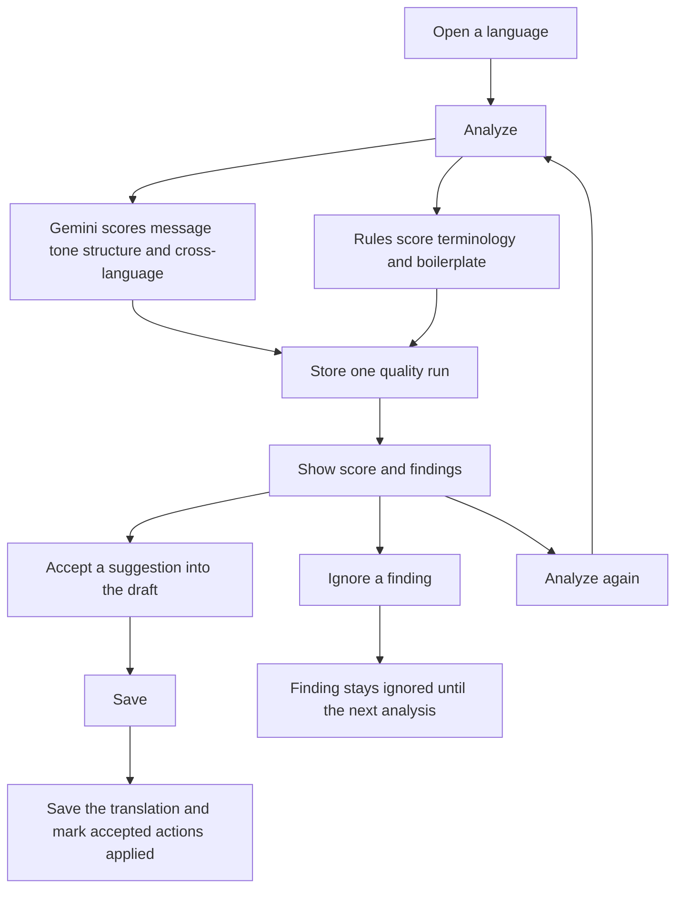
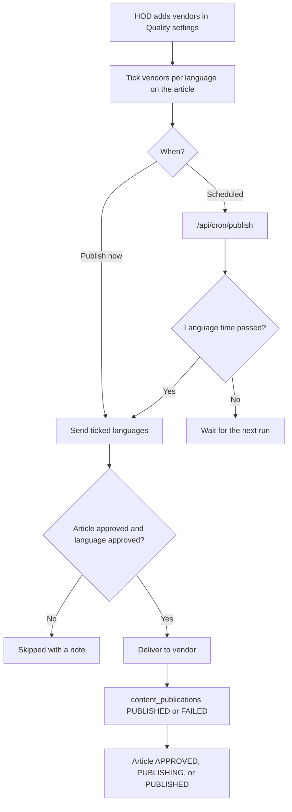

# Lingo — Translation Hub

Technical documentation · V0.1 · Under development

Lingo is the internal multilingual content hub for MR.DIY applications. Editors create source copy, generate or import translations, review them, and approve them before export or publish. The current environment is Next.js on Vercel with a Supabase PostgreSQL database.

---

## 1. Technical overview

| Field | Details |
| --- | --- |
| System name | Lingo — Translation Hub |
| Current version | V0.1 (`package.json` `0.1.0`) |
| System status | Under development |
| Environment | Supabase + Vercel (development) |
| Technology stack | Frontend and backend: Next.js. Database: Supabase (PostgreSQL). Translation: MyMemory for development, or Gemini with the quality key. OpenAI is the planned translation provider for QAT and production. Translation quality review: Google Gemini, plus terminology and boilerplate rules. |

---

## 2. System architecture



The browser never calls MyMemory, Gemini, or the database with a user credential. Pages and server actions run on the Next.js server. The server reads and writes Supabase with the project publishable key, and it calls the translation provider and Gemini from the server.

### 2.1 Application components

**Next.js application.** Provides the user interface and the server-side functions for translation management: applications, languages, content, string keys, import, export, comments, version history, and translation quality review. UI and mutations live in one App Router project. Mutations are server actions in `lib/actions/`.

**Supabase database.** Stores source content, translations, version history, workflow status, approvals, comments, users, application membership, quality categories, terminology, boilerplate, quality runs, publish vendors and deliveries, the review-email queue, and the article audit trail. Row-level security is enabled. Current policies allow the server role through; who can see or change an application is enforced in application code (`lib/auth/access.ts`).

**Translation service.** Receives source text from the Next.js server, returns translated text, and the server stores the result for review. The active provider is selected with `TRANSLATION_PROVIDER`: `mymemory`, `mock`, or `gemini`. Gemini uses the same `GEMINI_API_KEY` and `GEMINI_MODEL` as quality review. An OpenAI provider is planned for QAT and production and is not wired in V0.1.

**Quality review.** After a translation exists, the server can score it. Google Gemini scores message, tone, structure, and cross-language. Terminology and boilerplate are checked against lists stored in the database. The article screens do not call Gemini themselves.

**Publishing.** Each CONTENT application lists its own publish vendors. An approved article sends each ticked language to the vendors chosen for it, either at its scheduled time or with **Publish now**. Vendor integrations live in `lib/publish/integrations/`. V0.1 has one, a mock that posts to webhook.site.

**Review emails.** When an article enters `REVIEW`, a database trigger queues an email in `notification_outbox`. A cron route sends it over SMTP to everyone in that application who can approve.

**Joget.** MR.DIY’s existing portal. Joget does not share its session cookie with Lingo. It opens Lingo in an iframe with a short-lived signed token. People who are not coming from Joget sign in on `/sign-in` with email and password. Both paths end in the same `lingo_actor` session cookie.

### 2.2 Request path

1. `proxy.ts` runs on each request. Paths other than `/sign-in`, `/setup`, `/auth/*`, and `/embed*` require a valid `lingo_actor` cookie. A missing or expired cookie redirects to `/sign-in`.
2. The cookie is an HMAC-SHA256 token (`lib/auth/actor.ts`). The server verifies the signature with `JOGET_EMBED_SECRET` and checks expiry.
3. On the first authenticated request, Lingo upserts a `hub_users` row from the token (username, display name, email, optional employee ID) and refreshes `last_seen_at`.
4. Server actions then check application membership before reading or writing that application’s data.

### 2.3 Two product models

Every application is one of two models. The model is chosen when the application is created and drives the screens under that application.



| Model | Used for | Unit of work | Main screens |
| --- | --- | --- | --- |
| `STRING` | Product interface copy | A key inside a namespace, with one source string and one translation per language | Namespaces, translation keys |
| `CONTENT` | Press and editorial content | An article with a type, title, summary, HTML body, and SEO fields, plus one translation per target language | Types, articles |

---

## 3. Technology stack

### 3.1 Application framework

| Technology | Version | Purpose |
| --- | --- | --- |
| Next.js | 16.2.4 | Full-stack application framework (App Router, server actions) |
| React | 19.2.4 | User interface |
| TypeScript | ^5 | Type-safe application code |
| `@supabase/ssr` | ^0.12.7 | Server and browser Supabase clients, cookie session helper |

### 3.2 Database

| Technology | Version | Purpose |
| --- | --- | --- |
| Supabase JS | ^2.117.2 | Client library for Supabase |
| PostgreSQL | 17.11.0.002 | Relational store for application and translation data |
| Supabase | — | Managed PostgreSQL, used from the Next.js server |

Primary keys are time-ordered UUID v7 (`uuidv7()`), so new rows append in index order.

### 3.3 UI and application libraries

| Technology | Version | Purpose |
| --- | --- | --- |
| Tailwind CSS | ^4 | Styling |
| TipTap | ^3.31.4 | Article HTML body editor |
| PapaParse | ^5.7.0 | Read CSV on import |
| SheetJS (`xlsx`) | ^0.18.5 | Read Excel on import, write Excel on article export |
| Nodemailer | ^10.0.16 | Send review emails over SMTP |

### 3.4 Authentication and security

| Technology | Purpose |
| --- | --- |
| HMAC-SHA256 (`JOGET_EMBED_SECRET`) | Signs the Joget embed token and the `lingo_actor` session cookie |
| scrypt (Node.js `crypto`) | Password hash for email sign-in (`scrypt$salt$hash`) |
| httpOnly cookie | Session token is not readable from page JavaScript. On HTTPS the cookie is `Secure`, `SameSite=None`, and partitioned so it works inside the Joget iframe |
| Application access checks | Owner, invited member, and superadmin rules in `lib/auth/access.ts` |

### 3.5 External services

| Technology | Purpose |
| --- | --- |
| MyMemory | Temporary free translation API for development. Each request is truncated at 450 characters |
| OpenAI | Planned translation provider for QAT and production. Not implemented in V0.1 |
| Google Gemini | Scores article translations, and translates them when `TRANSLATION_PROVIDER=gemini`. The API key stays on the server |
| Supabase | Database. `pg_cron` and `pg_net` call the cron routes (`supabase/cron/notifications.sql`) |
| Vercel | Application hosting. Vercel Cron runs the publish route (`vercel.json`) |
| SMTP server | Sends review emails |
| webhook.site | Mock publish vendor for development |
| Joget | Identity source for iframe sign-in |

---

## 4. Data model

Schema is applied in order from `supabase/migrations/001` through `023`. Setup (`/setup`) shows which migrations the connected database still needs, up to 018. Later migrations are applied with `npm run db:migrate`. Service call logs are daily files on the server, not database tables. The article audit trail is a database table, `content_audit_events` (migration 023).

### 4.1 Tables

| Table | Description |
| --- | --- |
| `languages` | Languages available for translation. Each row has a code, a name, and a status of `ACTIVE` or `INACTIVE`. |
| `hub_users` | Lingo user directory. A row is created when someone signs in from Joget, signs in with email and password, or is invited before their first sign-in. Holds display name, username, email, employee ID, superadmin flag, the password hash used for email sign-in, and `ldap_role` (the job title, such as Executive). The job title is shown only. |
| `org_role_map` | The list of job titles (`ldap_role`). `band` decided approval before migrations 025 and 026 and is ignored after it. Maintained on the Job titles screen, and Joget adds new titles at sign-in. |
| `access_roles` | Roles such as Translator or Reviewer: name, description, and `application_id`. Each application keeps its own roles, maintained under its Settings → Roles. Rows with no `application_id` are the defaults copied into every new application (`copied_from` records the source), maintained by a superadmin on the Default roles screen. Names are unique per application. |
| `access_role_permissions` | Which permissions each role holds (`role_id`, `permission`). Mapped under each application's Settings → Roles, and for the defaults on the Default roles screen. |
| `applications` | Applications managed for translation. Each application is either `STRING` (product copy) or `CONTENT` (press articles), and has one owner. `notify_review_email` (default on) turns review emails on or off for that application. |
| `application_members` | Users invited to one application. `access_role_id` is the member's role and decides what they can do. The older `role`, `can_edit`, and `can_approve` columns are kept in step with it. |
| `namespaces` | Groups translation keys inside a STRING application. The name is unique per application. |
| `translation_keys` | A STRING key: key name, source language, and source text. The key is unique per application. |
| `translations` | The current string for one key and one language, plus status and the approval stamp. |
| `translation_versions` | Append-only history of a string translation. |
| `content_types` | Types owned by one CONTENT application. Each row has a stable `code`, a display `name`, a description, `ACTIVE` or `INACTIVE`, and a sort order. The code is unique per application. New articles default to `GENERAL`. An inactive type stays on articles that already use it and is hidden from new choices. Import creates a type when the file uses a code this app does not have yet. |
| `content` | An article in a CONTENT application. `content_type` is that app’s type code. Also stores title, slug, source language, source JSON, market, who submitted it, lifecycle status, target languages, and schedule and publish timestamps. `scheduled_publish_at` is the default publish time. `language_publish_at` (JSON, lower-case language code → ISO time) overrides it for one language. |
| `content_translations` | One translation of an article into one language: title, summary, body, SEO title, SEO description, status, and the approval stamp. |
| `content_translation_versions` | Append-only history of an article translation, stored as JSON of those five fields. |
| `article_comments` | A comment on an article, scoped to one language. |
| `quality_categories` | The checks used to score a translation. `category_type` is `ai` or `rule`. `enabled` turns a check on or off. `configuration.weight` is that check’s share of the score. Seeded checks: message 20, tone 15, structure 15, cross-language 25, terminology 15, boilerplate 10. The code is unique. `enabled` and the weight here are defaults; an application's own setting in `application_quality_settings` overrides them. |
| `application_quality_settings` | One application's `enabled` and `weight` (1–100) for one quality check. Primary key is application + category. Migration 022 copies the shared settings to every existing application. |
| `terminology` | A preferred wording for one source language and one target language, plus spellings to avoid. Each row belongs to one application (`application_id`, migration 021). One term is unique per application and language pair, ignoring case. `is_active` includes or excludes it from reviews. |
| `boilerplate_phrases` | A required standard phrase for one language. The name is unique per language, ignoring case. `expected_usage` is `when_source_present`: the phrase is required when the source contains the matching phrase. Seeded with the company introduction. |
| `quality_runs` | One quality analysis of an article translation. Stores provider, model, languages, status (`pending`, `running`, `completed`, `failed`), overall score, request and response metadata, and an error message. `content_translation_version_id` points at the saved version that was analyzed. That column is unique when it is set, so a saved version keeps one run. A draft analysis leaves it null. Deleting the article or that version deletes the run. |
| `quality_scores` | One category result on a run: category code, score from 0 to 100, band (`excellent`, `good`, `warning`, `critical`), summary, or an error message when that category did not score. |
| `quality_findings` | A problem found in a run: severity (`info`, `warning`, `error`, `critical`), title, explanation, source quote, translated quote, suggested wording, and field (`title`, `summary`, or `content`). |
| `quality_actions` | A suggested edit for one finding. `action_type` is `replace`, `insert`, `delete`, or `rewrite`. Status is `pending`, `applied`, or `ignored`. |
| `publish_vendors` | A publish destination owned by one CONTENT application. `type_code` picks the integration (V0.1 has `webhook_site`, a mock that posts to webhook.site). `config` (JSON) holds that integration's credentials, such as the URL and API key. `ACTIVE` or `INACTIVE`. The name is unique per application, ignoring case. |
| `content_publish_targets` | Which vendors one article language is sent to. Primary key is article + language + vendor. |
| `content_publications` | One delivery of one article language to one vendor. Status is `PENDING`, `PUBLISHED`, or `FAILED`, with the vendor's `external_url`, an error message, `attempted_at`, and `published_at`. Unique per article + vendor + language, so a retry updates the same row. |
| `notification_outbox` | Queue of review emails. A database trigger on `content` adds an `ARTICLE_REVIEW` row when an article enters `REVIEW`, unless one is already queued or was added in the last 15 minutes, or the application has review emails turned off. Status is `PENDING`, `SENDING`, `SENT`, `FAILED`, or `SKIPPED`. Stores attempts, the recipients already emailed (`sent_to`), and the last error. |
| `content_audit_events` | Append-only audit trail for articles. One row per event: `CREATED`, `STATUS_CHANGED`, `EDITED`, `TRANSLATION_SAVED`, `TRANSLATION_APPROVED`, `TRANSLATION_UNAPPROVED`, or `DELETED`. Stores the article id, application id, a copy of the article title, the language when the event is about one translation, `from_status` and `to_status`, and `detail` (JSON: changed fields, version number, reason, and `action_id`). The actor is `actor_name`, `actor_username`, and `actor_user_id`. `actor_name` is `System` for a scheduled publish with no signed-in person. A trigger rejects any update or delete. |

Deleting an application cascades to its namespaces, keys, translations, content types, terminology, publish vendors, articles, and memberships. Deleting an article cascades to its quality runs, publish targets, publications, and queued emails. Deleting a vendor cascades to its targets and publications. Deleting a run cascades to its scores, findings, and actions. `content_audit_events` has no foreign key to `content` or `applications`, so the audit trail stays after an article or application is deleted.

### 4.2 Article source fields

`content.source_content` and each content translation store the same five fields:

| Field | Notes |
| --- | --- |
| `title` | Plain text |
| `summary` | Plain text. Shown in the editor as the description |
| `body` | HTML from TipTap |
| `seo_title` | Plain text |
| `seo_description` | Plain text |

`content.source_language` is the language of the authoring pane. `content.target_languages` is the list of locales to translate into. The source language is excluded from that list.

### 4.3 Status

**Per-language translation status** (string translations and article translations):

| Status | Meaning |
| --- | --- |
| `MISSING` | No usable text yet |
| `SYSTEM_GENERATED` | Written by the translation provider |
| `MANUALLY_MODIFIED` | Written or edited by a person, or brought in by import |
| `APPROVED` | Signed off. Stores approver username, display name, user id, and time |

An editor save stores `MANUALLY_MODIFIED` and clears the approval stamp. An HOD save of an article language keeps an existing approval, and otherwise stores `MANUALLY_MODIFIED`. Approving is a separate step that records who approved it and when. A string edit stays `MANUALLY_MODIFIED` until someone approves it. A new version row is written only when the text or status actually changes.

**Article lifecycle** (`content.status`):

| Status | Meaning |
| --- | --- |
| `DRAFT` | Being written |
| `TRANSLATING` | An automatic translation run is in progress |
| `REVIEW` | Ready for a person to check translations |
| `APPROVED` | Every target language is approved. Ready to send to vendors |
| `PUBLISHING` | Live in some of the ticked languages and still waiting in others |
| `PUBLISHED` | Live in every ticked language. `published_at` is set the first time this status is saved |

`APPROVED`, `PUBLISHING`, and `PUBLISHED` are the publishable statuses. The publish runner moves an article between them based on how many ticked languages are live. A language ticked after the article is `PUBLISHED` moves it back to `PUBLISHING` until that language goes out.

**Version source** (`source_type`): `SYSTEM` (provider), `MANUAL` (editor), `IMPORT` (file).

**Article type:** each CONTENT application defines its own codes in `content_types`. `GENERAL` is the default. Existing articles may still use `ARTICLE`, `NEWS`, or `ANNOUNCEMENT`.

**Record status** for applications, languages, namespaces, and content types: `ACTIVE` or `INACTIVE`.

### 4.4 Quality score

The overall score is the weighted average of the category scores that succeeded. A check that is switched off, or that failed, is left out, and the remaining weights are scaled to 100. Bands: 90 and above excellent, 75 and above good, 60 and above warning, below 60 critical.

Message, tone, structure, and cross-language are scored by Gemini. Terminology and boilerplate are scored by rules against `terminology` and `boilerplate_phrases`. Accepting a suggestion does not change the stored score. A new analysis replaces it.

The review does not block publishing. Findings are a reference for the reviewer.

### 4.5 Audit trail

The server writes audit rows from application code (`lib/audit.ts`) after each change is saved. Every place that changes an article writes one: create, save, status change, auto-translate, language save and approval, quality-review save (`commit_content_translation_quality`), version delete, article delete, and the publish runner's status sync.

| Event | Written when |
| --- | --- |
| `CREATED` | An article is created |
| `STATUS_CHANGED` | `content.status` changes. `detail.reason` explains automatic moves, for example `Source text changed` or `2 of 2 languages live` |
| `EDITED` | Title, source text, source language, content type, target languages, market, or publish time changes (`detail.fields`). A deleted translation version is also recorded here |
| `TRANSLATION_SAVED` | A translation's text changes. `detail.version` is the new version number |
| `TRANSLATION_APPROVED` / `TRANSLATION_UNAPPROVED` | A language becomes approved, or its approval is cleared |
| `DELETED` | An article is deleted. The title and last status are kept |

Rows written in the same request share `detail.action_id`. The article page groups them into one Activity entry: the main action is the headline, and the changes it caused are listed under it.

Limits:

- A change made directly in the database, outside the app, is not recorded.
- If writing the audit row fails, the change is still saved. The failure goes to the server console and the service log (source `audit`).
- Articles changed before migration 023 have no history from before it.

---

## 5. Access control

Identity comes from Joget or from email sign-in. Lingo stores the person on `hub_users` and decides what they can open.

| Actor | What they can do |
| --- | --- |
| Signed-in user | See applications they own or were invited to. With none, they see "No applications yet". |
| Owner | Edit and approve that application. Invite and remove members, and give each member a role and job title. Roles do not limit the owner. |
| Member | View the application. Everything else follows the permissions mapped to the member's role (`application_members.access_role_id`). The job title (`hub_users.ldap_role`) is shown only. |
| Superadmin | Listed in `LINGO_SUPERADMINS` (username, email, or employee ID) and stored as `hub_users.is_superadmin`. The only one who can create an application. Opens every application, including ones with no owner. Edit, approve, and manage members on all of them. Uses Languages, Default roles, Job titles, Logs, and Setup. Can assign an owner. |

Every check runs on the server (`lib/auth/access.ts`). Viewing needs membership. Every other action needs one permission. The permissions are listed in `lib/auth/permissions.ts`; which roles hold them is stored in `access_role_permissions` and mapped under each application's Settings → Roles. Owners and superadmins hold every permission.

| Permission | Covers |
| --- | --- |
| `content.edit` | Create and edit articles, strings, catalog items, and translations. Drafts, submit for review, auto-translate, quality checks, delete articles |
| `content.import` | Import articles, strings, or catalog items from a file |
| `content.approve` | Approve content and translations, request changes, move articles to Approved or Published |
| `settings.general` | Application name, description, and status |
| `settings.notifications` | Review-email switch |
| `settings.content_types` | Article types |
| `settings.fields` | Catalog fields |
| `settings.quality` | Quality scoring, checks, and publish vendors |
| `settings.terminology` | Terminology entries |
| `people.manage` | Add and remove people and give them roles |
| `roles.manage` | Add, rename, and delete the application's roles and map their permissions |

Permissions are independent; none includes another. A person with `people.manage` can only give, change, or remove a role whose permissions they all hold, and cannot change their own role. Seeded roles match the old behaviour: Content writer and Translator hold `content.edit`, `content.import`, `settings.content_types`, and `settings.terminology`; Reviewer adds `content.approve`, `settings.notifications`, `settings.fields`, and `settings.quality`; Manager holds all of them. A person with `roles.manage` can only tick permissions they hold, and cannot change a role that holds permissions they lack. A role in use cannot be deleted. Each application keeps its own roles, so departments can shape their own workflow; changing the defaults on the Default roles screen only affects applications created afterwards. In code, `"edit"`, `"approve"`, and `"manage"` are shorthands for `content.edit`, `content.approve`, and `people.manage`.

Before migrations 025 and 026, a member's group comes from their job title (`hub_users.ldap_role`) through `org_role_map`: a title in the HOD group can approve, and any other title can edit and draft.

In the table below, "Editor" means a role with edit only, and "HOD and above" means a role that can approve.

### 5.1 Permissions by feature

| Feature | Editor | HOD and above | Owner and superadmin |
| --- | :---: | :---: | :---: |
| **Applications** | | | |
| See the application, its articles, and its stats | ✓ | ✓ | ✓ |
| Edit name, description, and status | | | ✓ |
| Invite and remove members, set roles and passwords (Settings → People) | | | ✓ |
| Assign an owner | | | Superadmin only |
| **Articles** | | | |
| Create an article: Save as draft | ✓ | ✓ | ✓ |
| Create an article: Submit for review | ✓ | | |
| Create an article: Save and approve | | ✓ | ✓ |
| Edit source text, type, market, schedule, and target languages | ✓ | ✓ | ✓ |
| Set the article to `APPROVED`, `PUBLISHING`, or `PUBLISHED` | | ✓ | ✓ |
| Delete articles | ✓ | ✓ | ✓ |
| Import articles (stored approved only for HOD and above) | ✓ | ✓ | ✓ |
| Export approved languages to Excel | ✓ | ✓ | ✓ |
| Comment | ✓ | ✓ | ✓ |
| View version history and the Activity trail | ✓ | ✓ | ✓ |
| Delete a translation version | ✓ | ✓ | ✓ |
| **Translations** | | | |
| Auto-translate (stored approved only for HOD and above) | ✓ | ✓ | ✓ |
| Save a language (never approves it) | ✓ | ✓ | ✓ |
| Approve a language, or clear its approval | | ✓ | ✓ |
| **Quality review** | | | |
| See scores and findings | ✓ | ✓ | ✓ |
| Analyze, recheck wording, accept or ignore suggestions | ✓ | ✓ | ✓ |
| Turn checks on or off and change weights (Settings → Quality) | | ✓ | ✓ |
| Add, edit, turn on or off, and delete terminology | ✓ | ✓ | ✓ |
| Boilerplate phrases | Database rows only. There is no screen | | |
| **Content types** (Settings → Types) | | | |
| Add, edit, and delete types | ✓ | ✓ | ✓ |
| **Publishing** | | | |
| Tick vendors for each language on an article | ✓ | ✓ | ✓ |
| **Publish now** (the article must already be approved) | ✓ | ✓ | ✓ |
| Add, edit, and delete vendors, and see their credentials (Settings → Quality → Publishing) | | ✓ | ✓ |
| **Notifications** | | | |
| Turn review emails on or off (Settings → General) | | ✓ | ✓ |
| Receive review emails | | ✓ | Owner only. A superadmin who is not a member gets none |
| **STRING applications** | | | |
| Namespaces, keys, translations, import, and auto-translate | ✓ | ✓ | ✓ |
| Approve a string translation | | ✓ | ✓ |
| **Platform** (superadmin only) | | | |
| Languages, Default roles, Job titles, Logs, and Setup | | | Superadmin only |

Saving a language never approves it. An approver's save keeps an existing approval, and approving is a separate step. An editor's save stores `MANUALLY_MODIFIED`, and an approved or published article returns to `REVIEW`.

Each application has its own terminology list, quality weights, content types, publish vendors, and review-email switch.

Applications created before access control have no owner. Until a superadmin sets one, only a superadmin can see them.

### 5.2 Session cookie

The session is the `lingo_actor` cookie. It holds a signed token: username, display name, email, optional employee ID, and expiry. It does not hold the password.

| Property | Value |
| --- | --- |
| Signature | HMAC-SHA256 with `JOGET_EMBED_SECRET` |
| Readable by page script | No. The cookie is httpOnly |
| On HTTPS | `Secure`, `SameSite=None`, and partitioned, so the Joget iframe can send it |
| On local HTTP | `SameSite=Lax` |
| Lifetime | 12 hours after Lingo accepts sign-in. The Joget link token itself lasts about 5 minutes |
| Sign-out | The cookie is cleared |

The cookie identifies the person. Each save, approval, and export checks `hub_users` and `application_members` on the server. Row-level security is enabled on the tables. Current database policies allow the server through, so those membership checks are what enforce access.

---

## 6. User flows

### 6.1 Sign in



Joget mints a token that expires in about five minutes. After Lingo accepts it, the session cookie lasts 12 hours. Later requests use the cookie only. Sign-out clears the cookie at `/embed/sign-out`.

Token payload (compact JSON, base64url, HMAC-SHA256 of that text):

```json
{"u":"ahmad","n":"Ahmad Lee","e":"ahmad@example.com","r":"Executive","eid":"E10293","exp":1710000000}
```

| Field | Required | Meaning |
| --- | --- | --- |
| `u` | Yes | Joget username |
| `n` | Yes | Display name. Replaces the name on the account at each sign-in |
| `e` | Yes | Company email. Lingo finds the person by email first, so invites made by email link on first sign-in. A token without an email is refused with 403 and a message to ask IT to add one |
| `r` | No | Role or title from Joget, such as Executive. Stored as the job title (`hub_users.ldap_role`) and added to the job title list if new. Display only; it grants nothing |
| `eid` | No | Employee ID |
| `exp` | Yes | Unix seconds. About five minutes ahead |

An SSO provider can replace Joget later by sending the same fields: email, name, and optionally a title.

**Inviting.** On an application's People settings, the owner or someone whose role has `people.manage` adds a person by email and picks a role and an optional job title. Name and password are optional. Without a password they sign in from Joget only, matched by email, and Joget fills in their name. With a password they can also sign in on `/sign-in`. "Set password" adds or changes one later. The person shows "Invited, not signed in yet" until their first sign-in.

Someone who opens Lingo from Joget without an invitation gets an account but sees "No applications yet" until they are added. Only a superadmin can create an application (`/applications/new`); they become its owner, can hand ownership to someone else, and add people.

### 6.2 Create an application and invite people



Inviting someone who has never signed in creates a `hub_users` row so the membership can be stored. They match that row on their first sign-in by email first, then username or employee ID.

### 6.3 Press article workflow

This is the main CONTENT flow.



Step by step:

1. A new article is saved with one of two buttons. An editor chooses **Save as draft** (`DRAFT`) or **Submit for review** (`REVIEW`). An HOD, owner, or superadmin chooses **Save as draft** (`DRAFT`) or **Save and approve** (`APPROVED`, and every translation saved with it is approved). An approver's draft is not approved until they approve it later. An import stores the status in the file, or `DRAFT`; an approver's import is stored as `APPROVED`. The type defaults to General. They set the source language, write title, description, HTML body, and SEO fields, and pick target languages. The source language is also stored as a translation row so the source text has history.
2. **Auto-translate** sends the live editor text to the translation service, one target language at a time. An editor’s run sets the article to `TRANSLATING`, then `REVIEW`, and each target is `SYSTEM_GENERATED`. An HOD’s run stores each target as `APPROVED`. A version is appended either way.
3. For an article, MyMemory translates title, summary, SEO title, and SEO description as four plain-text calls, and the body as one call per HTML text node so tags stay in place. A rich article is often about 20–25 MyMemory calls per language. Gemini sends the whole article in one call and returns the title, summary, body, and SEO fields separately.
4. Saving a language never approves it. An editor's save stores `MANUALLY_MODIFIED`. If the article was `APPROVED`, `PUBLISHING`, or `PUBLISHED`, it returns to `REVIEW`.
5. An approver's save keeps the language `APPROVED` if it already was, and otherwise stores `MANUALLY_MODIFIED`. Their save does not move the article back to `REVIEW`. To approve a language, the approver clicks **Approve** on it. The row stores who approved it and when.
6. When every language in `target_languages` is `APPROVED`, the article becomes `APPROVED`. An approver can also set the article to `APPROVED` from the editor, which approves every target language that has text.
7. Publishing sends each ticked language to its vendors (section 6.9). The article becomes `PUBLISHING` when the first language is live and `PUBLISHED` when all of them are, and `published_at` is stamped. Leaving `PUBLISHED` clears `published_at`.
8. Editing the source text of an approved or published article clears approval on every target language and returns the article to `REVIEW`. Changing type, market, schedule, source language, or the target list does not.
9. Export is separate from approval. On the article list, an editor selects articles and downloads Excel. Source columns are always filled. A language is filled only when that translation is already approved. An article with no approved target language is skipped, and languages that are not approved stay blank.

The article list sorts by the nearest `scheduled_publish_at` and can filter overdue, due within 24 hours, scheduled, no date, or published.

Comments sit on the article and are filtered by the language open in the editing pane. The author name comes from the session.

Copy beside Title, Description, and Body copies plain text for title and description, and the current HTML for body.

### 6.4 Per-language translation status

The same four statuses apply to product strings and to article languages.



### 6.5 Product string workflow

STRING applications skip the article lifecycle. Work is per key.



1. Create a namespace (for example `common` or `checkout`).
2. Create a key (`button.save`) with a source language and source text.
3. Auto-translate calls the provider once per target language and stores `SYSTEM_GENERATED`.
4. Editors can replace the text (`MANUALLY_MODIFIED`) and approvers can mark a language `APPROVED`.
5. Each change appends `translation_versions`. The current value stays on `translations.current_text`.

There is no article-level `DRAFT` → `PUBLISHED` state for strings.

### 6.6 Import



**Strings.** Required columns are namespace and key, plus language columns. Preview classifies each row:

| Preview | Rule |
| --- | --- |
| `NEW` | Key does not exist in the application |
| `UPDATED` | Key exists and source or a language cell differs |
| `UNCHANGED` | Key exists and the file matches stored text |
| `ERROR` | Missing namespace or key |

A namespace named in the file is created on confirm if it does not exist yet.

**Articles.** Required columns are `title` and `source_language`. Optional columns: `content_type`, `status`, `summary`, `body`, `seo_title`, `seo_description`, and `{lang}_{field}` such as `ms_title` or `en_body`. A blank `content_type` becomes General. A code this app does not have yet is created on confirm. An HOD import stores supplied translations as `APPROVED`. An editor import stores them as `MANUALLY_MODIFIED`.

Each valid article row is inserted as a new article. The file is not matched to an existing article by title or slug. Invalid rows (missing title) are `ERROR` and are skipped. Optional auto-translate runs only for target languages that the file did not already supply.

### 6.7 Export articles

From the article list, an editor selects rows and exports `.xlsx`.

- Source columns are always filled: `title`, `source_language`, `content_type`, `status`, `summary`, `body`, `seo_title`, `seo_description`.
- Language columns (`{lang}_title`, `{lang}_body`, and the other three fields) are filled only when that translation is `APPROVED`.
- An article with no approved target language is skipped.
- The screen reports how many articles were skipped and which languages were left blank because they were not approved.
- Language codes keep their stored case (for example `zh-Hans`).

### 6.8 Review translation quality

Quality review is available on an article translation. It does not change article status and does not block publish. File-by-file behavior for analyze and apply is in `docs/translation-quality.md`.



1. **Analyze** sends the source and the translation to Gemini for the AI checks that are on, and runs terminology and boilerplate locally. The result is one `quality_runs` row with scores, findings, and actions. Token counts are stored on the run when Gemini returns them, and the prompt and reply are written to the daily service log.
2. A saved translation that already matches the latest version is attached to that version. One version holds one run. **Analyze again** replaces it. Text that does not match the saved version is stored as a draft run until a later save matches that analyzed text.
3. **Accept** writes the suggestion into the editor only. The database stays unchanged until **Save**. Save writes the translation and marks those actions `applied` in one database function, `commit_content_translation_quality`.
4. **Ignore** marks the action `ignored` immediately. The finding stays hidden until the next analysis.
5. **Recheck wording** runs terminology and boilerplate again on the saved version. It does not call Gemini.
6. HOD and above edit weights and terminology under the application’s Quality settings. Boilerplate phrases are the rows in `boilerplate_phrases`.

On the review rail, an `info` finding is a Note, a `warning` is a Check, and `error` or `critical` is a Blocker. Those labels do not stop publishing.

### 6.9 Publish to vendors



1. A vendor is added under the application's Quality settings (`#publishing`) with an integration type and its credentials. Only active vendors are used.
2. On the article, each language is ticked for one or more vendors (`content_publish_targets`).
3. A language's publish time is its own entry in `language_publish_at`, or else `scheduled_publish_at`.
4. The publish runner (`lib/publish/run.ts`) picks up articles in a publishable status, takes up to 25 per status at a time, and sends every ticked language whose time has passed. **Publish now** sends every ticked language for one article, whatever its time.
5. The source language goes out from the source content. Any other language must be `APPROVED`, or it is skipped.
6. Each delivery claims a `content_publications` row as `PENDING`, then stores `PUBLISHED` with the vendor link, or `FAILED` with the error. A language already `PUBLISHED` for that vendor is not sent again. A `PENDING` row that is still in flight is skipped.
7. The article status is then synced from how many ticked languages are live (section 4.3).

`/published/[id]` redirects to the vendor's public link for a publication, or shows why there is none (missing, pending, failed, or no link returned).

### 6.10 Review emails

1. An article enters `REVIEW` by any path (save, translation run, import, or the quality-review save). The `trg_content_review_notice` trigger queues one `ARTICLE_REVIEW` row in `notification_outbox`.
2. Nothing is queued when the application has review emails turned off, or when a notice for that article is still queued or was added in the last 15 minutes. A machine translation run moves the article to `REVIEW` once per language, so this keeps it to one email.
3. `/api/cron/notifications` claims up to 20 queued rows with `claim_notification_outbox` and emails the owner and every member who can approve. The email links to the article through `APP_BASE_URL`.
4. A row is `SKIPPED` when the article has left `REVIEW`, review emails were turned off, or no approver has an email address. A failed send goes back to `PENDING` and is retried, up to 5 attempts, then ends as `FAILED`. `sent_to` remembers who already got the email, so a retry only goes to the rest. `last_error` holds the reason.

Review emails are switched on or off per application under Settings → General → Notifications.

---

## 7. Translation service

`lib/translation/service.ts` exposes one interface: `translateText` and `translateArticle`. `getTranslationService()` reads `TRANSLATION_PROVIDER`.

| Provider | When | Behaviour |
| --- | --- | --- |
| `mymemory` (default) | Development | `https://api.mymemory.translated.net/get`, language pair `source\|target`. Text longer than 450 characters is cut and the result is marked with `[…]`. A failed call falls back to a `[lang] ` prefix so the editor still receives text |
| `mock` | Offline demos | Prefixes the source with `[lang] ` and does not call the network |
| `gemini` | Testing with the quality key | Title, summary, and SEO fields go out in one JSON call. An HTML body is not rewritten by the model: tags stay in place and the words between them are translated in small batches. A failed call is reported and is not stored. The prompt and reply are written to the service log |
| OpenAI | QAT / production | Planned. Same interface, so screens and version history stay unchanged when the provider is swapped |

Language codes sent to MyMemory are normalized: `zh-Hans` → `zh-CN`, `zh-Hant` → `zh-TW`. Other codes use the part before the hyphen when they are not in the map.

HTML bodies from MyMemory are split on tags. Only text nodes are translated. Attributes and markup are copied through. If that pass returns no visible text, the service strips tags and translates the plain text once. Gemini does the same for an HTML body: the original tags are copied back around the translated words.

Auto-translate prefers text currently in the editor over the last saved copy, and it ignores an empty editor field so a blank TipTap state cannot wipe a saved body.

---

## 8. Screens

| Route | Who | What it does |
| --- | --- | --- |
| `/` | Signed-in | Dashboard: application counts, language counts, string coverage, article lifecycle counts |
| `/sign-in` | Public | Email and password |
| `/embed` | Joget | Accepts the embed token, sets the cookie, redirects |
| `/applications` | Signed-in | Applications the user can see |
| `/applications/new` | Signed-in | Create STRING or CONTENT application |
| `/applications/[id]` | Member | Application home and access panel |
| `/applications/[id]/edit` | Owner or superadmin | Name, description, status, owner |
| `/applications/[id]/namespaces` | STRING member | Namespaces |
| `/applications/[id]/translations` | STRING member | Keys and per-language status |
| `/applications/[id]/articles` | CONTENT member | Article list, filters, selection, export, bulk delete |
| `/applications/[id]/articles/[contentId]` | CONTENT member | Article view, quality review, history, activity (audit trail), comments |
| `/applications/[id]/articles/[contentId]/edit` | CONTENT member who can edit | Dual-pane editor, translate, save, quality review |
| `/applications/[id]/settings/general` | CONTENT member | Application details and the review-email switch (`#notifications`). HOD and above can change the switch |
| `/applications/[id]/settings/people` | Owner or superadmin | Members and their roles |
| `/applications/[id]/settings/types` | CONTENT member who can edit | Content types for that application |
| `/applications/[id]/settings/quality` | CONTENT member | Scoring weights, terminology, and publish vendors (`#publishing`). HOD and above can change them |
| `/published/[id]` | Public | Redirects to the vendor's public link for one publication |
| `/api/cron/publish` | Cron, with `CRON_SECRET` | Runs scheduled publishing |
| `/api/cron/notifications` | Cron, with `CRON_SECRET` | Sends queued review emails |
| `/applications/[id]/import` and `/import` | Editor | Import wizard |
| `/languages` | Superadmin | Create and activate or deactivate languages |
| `/roles` | Superadmin | Default roles: a template copied into each new application |
| `/job-titles` | Superadmin | The list of job titles. Display only |
| `/applications/[id]/settings/roles` | `roles.manage` | This application's roles and their permission map |
| `/logs` | Superadmin | Service call logs: input, output, and token counts. One file per day, deleted after the retention window |
| `/setup` | Superadmin, or anyone while no superadmin exists yet | Migration checklist |

Inside a STRING application the sub-navigation is namespaces and translations. Inside a CONTENT application it is articles, with settings for types and quality.

---

## 9. Environment and deployment

Local and Vercel configuration (`.env.local` / Vercel project env):

| Variable | Role |
| --- | --- |
| `NEXT_PRIVATE_SUPABASE_URL` | Supabase project URL |
| `NEXT_PRIVATE_SUPABASE_PUBLISHABLE_KEY` | Supabase key used by the Next.js server |
| `TRANSLATION_PROVIDER` | `mymemory`, `mock`, or `gemini` |
| `QUALITY_PROVIDER` | Quality model provider. `gemini` |
| `GEMINI_API_KEY` | Server-only key for quality analysis |
| `GEMINI_MODEL` | Gemini model. Default `gemini-3.5-flash-lite` |
| `SERVICE_LOG_RETENTION_DAYS` | How many daily log files to keep. Default 7 |
| `JOGET_EMBED_SECRET` | Shared secret for embed tokens and session cookies |
| `LINGO_SUPERADMINS` | Comma-separated usernames, emails, or employee IDs |
| `JOGET_FRAME_ANCESTORS` | Origins allowed to iframe the app. Default `*` |
| `EMBED_ALLOW_DEV` | Local stand-in for Joget. Leave unset in production |
| `SUPABASE_INSECURE_SSL` | Optional, for corporate SSL inspection |
| `CRON_SECRET` | Bearer token the cron routes require. Without it, only Vercel Cron on Vercel is accepted |
| `APP_BASE_URL` | Public Lingo URL, used for the article link in review emails |
| `SMTP_HOST`, `SMTP_PORT`, `SMTP_USER`, `SMTP_PASS` | SMTP server for review emails. Port defaults to 465 (TLS). 587 uses STARTTLS. Without host, user, and password, emails are not sent |
| `MAIL_FROM` | Sender address. Defaults to `SMTP_USER` |

Migrations, in order:

1. `001_translation_hub.sql` — core schema
2. `002_version_approval.sql` — only when upgrading an older database that had version approval columns
3. `003_content_publishing.sql` — slug, schedule, published time
4. `004_content_target_languages.sql` — `content.target_languages`
5. `005_article_comments.sql` — comments, approver name, version username
6. `006_uuidv7.sql` — UUID v7 defaults for new rows
7. `007_rewrite_uuidv7.sql` — rewrite existing primary keys to v7. Old URLs stop working
8. `008_access_control.sql` — users, owners, members
9. `009_password_sign_in.sql` — `password_hash` for email sign-in
10. `010_content_list_meta.sql` — article market and submitted by
11. `011_member_roles.sql` — Editor, HOD, and Admin on membership
12. `012_org_role_map.sql` — group account titles into Editor or HOD and above
13. `013_content_types.sql` — per-application content types
14. `014_translation_quality.sql` — quality categories, terminology, boilerplate, runs, scores, findings, actions
15. `015_quality_run_version.sql` — one quality run per saved translation version
16. `016_publish_vendors.sql` — publish vendors, article publish targets, and publications
17. `017_publish_language_targets.sql` — each article language goes to its own vendors
18. `018_language_publish_schedule.sql` — per-language publish times and the `PUBLISHING` status
19. `019_notification_outbox.sql` — review-email queue and the trigger that fills it
20. `020_review_email_setting.sql` — per-application review-email switch
21. `021_terminology_per_application.sql` — each application keeps its own terminology. Removes the old shared list
22. `022_quality_settings_per_application.sql` — each application keeps its own quality checks and weights
23. `023_content_audit_events.sql` — article audit trail (`content_audit_events`)
24. `024_catalog.sql` — catalog applications
25. `025_access_roles.sql` — roles (`access_roles`) and `application_members.access_role_id`. Approvers become Reviewer; everyone else becomes Content writer
26. `026_access_role_permissions.sql` — permission map per role (`access_role_permissions`). Converts the edit, approve, and manage switches from 025 and drops them
27. `027_application_roles.sql` — roles per application. Copies the default roles into every application, moves members onto their application's copy, and adds `roles.manage` wherever `people.manage` was

`npm run db:migrate` applies every pending file and records it in `_migrations`.

Cron jobs:

| Job | Schedule | Set up in |
| --- | --- | --- |
| Scheduled publishing, `/api/cron/publish` | Daily at 08:00 UTC (16:00 Malaysia time) | `vercel.json` (Vercel Cron). `supabase/cron/notifications.sql` has an optional `pg_cron` job to use instead |
| Review emails, `/api/cron/notifications` | Every minute, only when something is queued | `supabase/cron/notifications.sql` (`pg_cron` + `pg_net`). Run it once per environment after migration 019, with the app URL and `CRON_SECRET` stored in Vault. It is not a migration |

```bash
npm install
npm run dev
```

Production build: `npm run build`, then `npm run start`, or the Vercel deployment of the same build.

The Joget iframe host must be HTTPS so the session cookie is accepted inside a cross-site frame. Joget replaces the shared secret in a Bean Shell userview menu and points the iframe at `https://<lingo-host>/embed?token=<token>&next=/`.

---

## 10. Operational notes for V0.1

- MyMemory is a development stand-in. It rate-limits, truncates at 450 characters, and is not the QAT or production translator. Swapping in OpenAI means a new `TranslationProvider` behind `getTranslationService()`, without a change to article or key screens.
- Database policies are open to the server. Authorization is the membership check in server actions. A future pass can mirror those rules in Postgres row-level security.
- Article import always inserts. It does not update an article that is already in the hub. String import does update an existing key.
- Export is an approved-language extract. Unapproved translations stay out of the file on purpose.
- Version rows are history. Deleting a version removes that snapshot. It does not roll the current translation back by itself. Deleting a version also deletes the quality run attached to it.
- Quality findings are a reference. They do not gate `PUBLISHED`.
- Scheduled publishing runs once a day by default. A publish time is reached at the next run, not to the minute. Use **Publish now** for an immediate send.
- The only publish integration in V0.1 is the webhook.site mock. A real vendor is a new class in `lib/publish/integrations/`, added to `registry.ts`.
- Review emails need SMTP and the `pg_cron` job. Without SMTP, queued rows stay `PENDING` and are retried until they fail.
- Service logs are JSON lines in `logs/service-YYYY-MM-DD.jsonl` on the machine running the app. They are not in Postgres and they are not committed. Files older than `SERVICE_LOG_RETENTION_DAYS` (default 7) are deleted. Do not use them as an audit record.
- The article audit trail is `content_audit_events` in Postgres. It is append-only and is kept after an article is deleted. See section 4.5.
